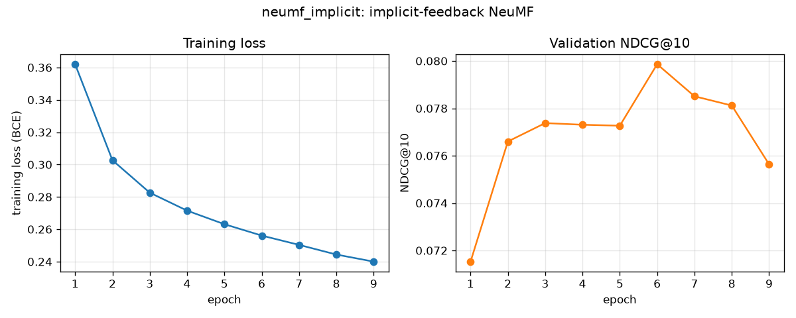

# Neural Movie Recommender

A movie recommendation system built in PyTorch and trained on the
[MovieLens 1M](https://grouplens.org/datasets/movielens/1m/) dataset
(1,000,209 ratings from 6,040 users on about 3,700 movies).

## Plan

- **Baseline:** matrix factorization (user and movie embeddings with biases).
- **Main model:** Neural Collaborative Filtering (NeuMF) with movie genre features.
- **Evaluation:** RMSE for rating prediction, Hit Rate@10 and NDCG@10 for ranking.
- **App:** a web app where a new user rates a few movies, the app learns an
  embedding for them on the fly, and shows personalized top-10 recommendations.

## Setup

Requires Python 3.12+ and an NVIDIA GPU is recommended (CPU works, just slower).

```powershell
python -m venv C:\Users\<you>\venvs\movierec
C:\Users\<you>\venvs\movierec\Scripts\Activate.ps1
pip install -r requirements.txt
python -m movie_rec.check_env
```

`requirements.txt` pins the CUDA 12.6 build of PyTorch. On a machine without an
NVIDIA GPU, change that line to `torch==2.14.1` to get the CPU build.

The virtual environment is kept outside the repo so it isn't committed or synced
to cloud storage.

## Data

```powershell
python -m movie_rec.data
```

This downloads MovieLens 1M into `data/raw/`, then writes cleaned files to
`data/processed/`:

- User and movie IDs are remapped to contiguous 0-based indices so they can be
  used directly as embedding rows. The 177 listed movies with no ratings are dropped,
  leaving 3,706 movies.
- Each user's ratings are split **by time**: the oldest 80% go to training, the
  next 10% to validation, and the most recent 10% to test. This mirrors real use,
  where the model predicts what a user will rate next, and avoids training on a
  user's future ratings. Every user appears in all three splits.
- The few validation/test ratings for movies that never appear in training
  (18 and 36 ratings) are dropped, because those movies have no trained embedding.
- Genres are kept as a multi-hot feature (18 genres) for the NeuMF model.

| Split      | Ratings |
|------------|--------:|
| Train      | 800,309 |
| Validation |  99,932 |
| Test       |  99,914 |

## Training

```powershell
python -m movie_rec.train --model mf
```

Trains with Adam on mean squared error, checks validation RMSE after every epoch,
stops early once it stops improving for 3 epochs, and keeps the best weights.
Saves the model to `models/<name>.pt` and the metrics and a training curve to
`results/`.

### Baseline: matrix factorization

Predicted rating = global mean + user bias + movie bias + (user vector · movie vector),
with 32-dimensional vectors (321,619 parameters). About 6 seconds per epoch on an
RTX 3050.

| Model                                 | Weight decay | Val RMSE | Test RMSE |
|---------------------------------------|-------------:|---------:|----------:|
| Always predict the training mean      |            - |        - |    1.1654 |
| Matrix factorization                  |            0 |   0.8615 |    0.8818 |
| Matrix factorization (**default**)    |         1e-5 |   0.8588 |    0.8793 |
| Matrix factorization                  |         1e-4 |   0.8938 |    0.9159 |

Without regularization the model starts overfitting after about 7 epochs
(training error keeps falling while validation error rises). A weight decay of
1e-5 delays that slightly and gives the best validation score; 1e-4 is too strong
and underfits. Test RMSE is higher than validation RMSE because the test ratings
are each user's most recent ones, further from the training period.


### Main model: NeuMF with genres

```powershell
python -m movie_rec.train --model neumf
```

Neural Collaborative Filtering (He et al., 2017), adapted to predict star ratings.
Two branches look at each user-movie pair, each with its own 32-dimensional vectors:

- **GMF branch:** element-wise product of the user and movie vectors. Matrix
  factorization adds these products up with equal weight; here a learned layer
  weights each dimension.
- **MLP branch:** the user vector, movie vector, and an 8-dimensional embedding of
  the movie's genres go through hidden layers of 64, 32, and 16 units (ReLU,
  dropout 0.5), which can learn non-linear interactions a dot product can't.

A final linear layer combines the two branches, and the global, user, and movie
biases from matrix factorization are kept. 640,972 parameters, about 11 seconds
per epoch.

| Variant                                              | Val RMSE | Test RMSE |
|------------------------------------------------------|---------:|----------:|
| Matrix factorization baseline                        |   0.8588 |    0.8793 |
| NeuMF, dropout 0.2                                   |   0.8675 |    0.8859 |
| NeuMF, dropout 0.5 (**default**)                     |   0.8655 |    0.8853 |
| NeuMF, dropout 0.2, no genres                        |   0.8704 |    0.8907 |
| NeuMF, dropout 0.2, 16-dimensional vectors           |   0.8679 |    0.8869 |
| NeuMF, dropout 0.2, weight decay 3e-5                |   0.8772 |    0.8968 |
| NeuMF initialized from MF, fine-tuned (lr 1e-4)      |   0.8599 |    0.8803 |
| NeuMF initialized from MF, fine-tuned (lr 3e-4)      |   0.8620 |    0.8824 |
| NeuMF initialized from MF, MF weights frozen         |   0.8657 |    0.8858 |

**NeuMF does not beat matrix factorization on rating accuracy.** It has twice as
many parameters and overfits sooner (best epoch 5 vs. 10). Genres do help: removing
them makes every metric worse. This matches Rendle et al. (2020), *Neural
Collaborative Filtering vs. Matrix Factorization Revisited*, which found that a
well-tuned dot-product model usually beats NeuMF.

Following the original NeuMF paper, I also tried pretraining: `--init-from
models/mf.pt` copies the trained matrix factorization vectors and biases into NeuMF
so it starts with exactly the baseline's predictions (val RMSE 0.8588), then
fine-tunes. Every fine-tuning setup made validation RMSE slightly worse, even with
the copied weights frozen (`--freeze-pretrained`). At its best epoch matrix
factorization already fits the training data closely (training RMSE about 0.74),
so the remaining training error is mostly noise and the extra network learns that
noise instead of real patterns.


## Ranking evaluation

```powershell
python -m movie_rec.train_implicit   # trains neumf_implicit (about 6 minutes)
python -m movie_rec.evaluate         # compares every model (about 11 minutes)
```

RMSE only measures how close predicted stars are. What a user actually sees is a
top-10 list, so each model is also evaluated as a recommender:

- For every user, score **all** movies they haven't rated yet and take the top 10.
  Ranking against the full catalog avoids the misleading results of ranking against
  ~100 sampled movies (Krichene & Rendle, 2020).
- A recommendation is a **hit** if the user rated that movie 4 or 5 stars in the
  held-out period (validation or test). Users with no 4-5 star ratings in that
  period are skipped, leaving 5,805 validation and 5,772 test users.
- **HR@10:** share of users with at least one hit in their top 10.
  **Precision@10:** share of the 10 recommendations that are hits.
  **NDCG@10:** like precision, but hits near the top count more.
  **Coverage:** share of the catalog that appears in anyone's top 10.

| Test set (5,772 users)                   | RMSE   | HR@10  | Prec@10 | NDCG@10 | Coverage |
|------------------------------------------|-------:|-------:|--------:|--------:|---------:|
| Popularity (same list for everyone)      |      - | 0.2635 |  0.0428 |  0.0556 |     4.0% |
| Matrix factorization                     | 0.8793 | 0.2514 |  0.0396 |  0.0538 |    22.3% |
| Matrix factorization + popularity (α=1.5)| 0.8793 | 0.2997 |  0.0516 |  0.0690 |     6.4% |
| NeuMF (ratings)                          | 0.8853 | 0.2450 |  0.0380 |  0.0515 |    21.3% |
| NeuMF (ratings) + popularity (α=1.0)     | 0.8853 | 0.2995 |  0.0515 |  0.0693 |     7.8% |
| NeuMF (implicit)                         |      - | 0.3136 |  0.0485 |  0.0698 |    37.7% |
| **NeuMF (implicit) + popularity (α=0.75)** |    - | **0.3382** | **0.0554** | **0.0788** | 22.2% |

### What happened and how it was fixed

**1. The rating models lose to "recommend the most popular movies."** Both rating
models score below the popularity baseline on every ranking metric. This is a known
effect (Cremonesi et al., 2010): a model trained to predict stars estimates how much
a user would like a movie *if they watched it*, so ranking by predicted stars pushes
up obscure films a handful of people loved. A hit also requires the user to actually
*watch* the movie, which popularity captures.

**2. Blending in popularity.** Ranking by
`predicted rating + α · log(1 + number of ratings)` combines "would they like it"
with "would they watch it." α is chosen on the validation set (grid from 0 to 2),
then applied unchanged to test. This lifts matrix factorization's test NDCG@10 from
0.054 to 0.069, beating popularity by 24%, at the cost of lower coverage.

**3. Training NeuMF for ranking instead of ratings.** NeuMF was originally designed
for implicit feedback: predicting *which* movies a user interacts with, not how many
stars they give. `train_implicit.py` trains it that way: each of a user's 4-5 star
training ratings is a positive, 4 random movies per positive are negatives
(resampled every epoch), the loss is binary cross-entropy, and early stopping uses
validation NDCG@10. On its own it beats every rating model on hit rate while
covering 38% of the catalog.

| Implicit NeuMF positives          | Val NDCG@10 | Test HR@10 | Test NDCG@10 |
|-----------------------------------|------------:|-----------:|-------------:|
| 4-5 star ratings (**default**)    |      0.0799 |     0.3136 |       0.0698 |
| All ratings                       |      0.0679 |     0.2691 |       0.0551 |

Using every rating as a positive is worse: it teaches the model to recommend movies
people watched and disliked.

**4. Final model.** Implicit NeuMF plus a light popularity blend (α=0.75) is the
best on every ranking metric: test NDCG@10 of 0.0788 is **42% higher than
popularity** and 14% higher than the best rating model, while still recommending
from 22% of the catalog (vs. 4% for popularity). This is the model used by the app.



## Web app

```powershell
python -m movie_rec.app      # then open http://127.0.0.1:7860
```

Requires `models/neumf_implicit.pt` (from `python -m movie_rec.train_implicit`).
Built with Gradio; two tabs:

**Recommend for me (cold start).** Pick movies you liked and, optionally, movies you
disliked and genres to restrict to. You aren't one of the 6,040 users the model was
trained on, so the app learns vectors for you on the spot ("fold-in"):

- The trained network is frozen. Only a new user's GMF vector, MLP vector, and bias
  are optimized: 100 Adam steps with the same objective used in training (liked
  movies are positives; disliked movies plus 4 random movies per like are
  negatives), with an L2 penalty pulling the vectors toward the average user so a
  couple of picks don't produce extreme results.
- This takes about 0.25 seconds on the GPU. A first version took 3.3 seconds
  because each of its 200 steps made separate small GPU calls; drawing all random
  negatives in one batch and halving the steps (with a higher learning rate) made
  it 13x faster with the same recommendations.
- Each recommendation shows **"Because you liked"**: the picked movie whose learned
  movie vector is most similar (cosine similarity) to the recommended one.
- A **popularity weight** slider (default 0.75, tuned on validation) trades niche
  picks for mainstream ones live.

**Check against a real user.** Enter a MovieLens user ID to see their favorite movies
from training and the model's top 10. The **"Rated 4-5 stars later?"** column marks
recommendations the user really did rate highly in the held-out test period, which
the model never saw. The example users (2873, 2247, 1820, 3412) are ones where the
model gets 5-7 of the top 10 right; user 1 gets 0, which is typical of the
long tail behind the 0.34 average hit rate.

## Project layout

```
movie_rec/          Python package with all project code
  config.py         paths, random seed, device selection
  check_env.py      verifies library versions and GPU training
  data.py           download, cleaning, time-based split, PyTorch data loaders
  models.py         matrix factorization and NeuMF architectures
  train.py          rating-prediction training loop, early stopping, RMSE evaluation
  train_implicit.py NeuMF trained for ranking with negative sampling
  evaluate.py       top-10 ranking metrics, popularity baseline and blending
  recommender.py    fold-in for new users, top-10 lists, "because you liked"
  app.py            Gradio web app
results/            metrics (JSON) and training curves for each run
data/               downloaded and processed datasets (not committed)
models/             trained model checkpoints (not committed)
```
