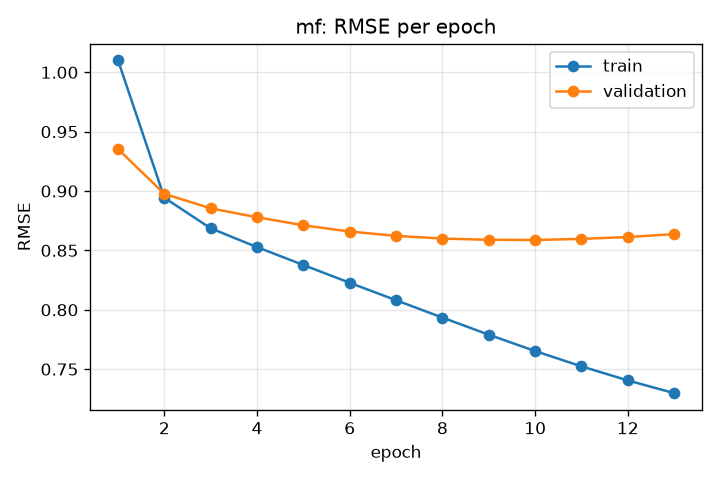
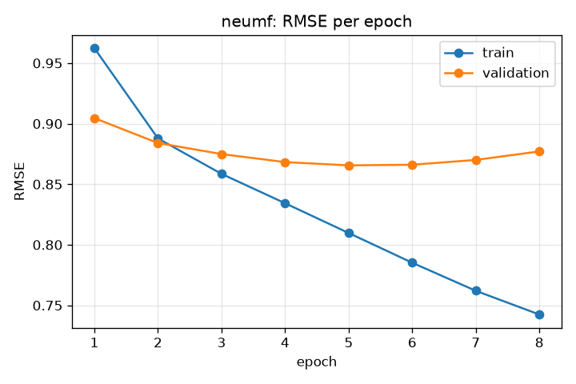

# Neural Movie Recommender

A movie recommendation system built in PyTorch and trained on the
[MovieLens 1M](https://grouplens.org/datasets/movielens/1m/) dataset
(1,000,209 ratings from 6,040 users on about 3,700 movies).

## Plan

- **Baseline:** matrix factorization (user and movie embeddings with biases).
- **Main model:** Neural Collaborative Filtering (NeuMF) with movie genre features.
- **Evaluation:** RMSE for rating prediction, Hit Rate@10 and NDCG@10 for ranking.
- **App:** a web app where a new user rates a few movies, the app learns an
  embedding for them on the fly, and shows personalized top-10 recommendations.

## Setup

Requires Python 3.12+ and an NVIDIA GPU is recommended (CPU works, just slower).

```powershell
python -m venv C:\Users\<you>\venvs\movierec
C:\Users\<you>\venvs\movierec\Scripts\Activate.ps1
pip install -r requirements.txt
python -m movie_rec.check_env
```

`requirements.txt` pins the CUDA 12.6 build of PyTorch. On a machine without an
NVIDIA GPU, change that line to `torch==2.14.1` to get the CPU build.

The virtual environment is kept outside the repo so it isn't committed or synced
to cloud storage.

## Data

```powershell
python -m movie_rec.data
```

This downloads MovieLens 1M into `data/raw/`, then writes cleaned files to
`data/processed/`:

- User and movie IDs are remapped to contiguous 0-based indices so they can be
  used directly as embedding rows. The 177 listed movies with no ratings are dropped,
  leaving 3,706 movies.
- Each user's ratings are split **by time**: the oldest 80% go to training, the
  next 10% to validation, and the most recent 10% to test. This mirrors real use,
  where the model predicts what a user will rate next, and avoids training on a
  user's future ratings. Every user appears in all three splits.
- The few validation/test ratings for movies that never appear in training
  (18 and 36 ratings) are dropped, because those movies have no trained embedding.
- Genres are kept as a multi-hot feature (18 genres) for the NeuMF model.

| Split      | Ratings |
|------------|--------:|
| Train      | 800,309 |
| Validation |  99,932 |
| Test       |  99,914 |

## Training

```powershell
python -m movie_rec.train --model mf
```

Trains with Adam on mean squared error, checks validation RMSE after every epoch,
stops early once it stops improving for 3 epochs, and keeps the best weights.
Saves the model to `models/<name>.pt` and the metrics and a training curve to
`results/`.

### Baseline: matrix factorization

Predicted rating = global mean + user bias + movie bias + (user vector · movie vector),
with 32-dimensional vectors (321,619 parameters). About 6 seconds per epoch on an
RTX 3050.

| Model                                 | Weight decay | Val RMSE | Test RMSE |
|---------------------------------------|-------------:|---------:|----------:|
| Always predict the training mean      |            - |        - |    1.1654 |
| Matrix factorization                  |            0 |   0.8615 |    0.8818 |
| Matrix factorization (**default**)    |         1e-5 |   0.8588 |    0.8793 |
| Matrix factorization                  |         1e-4 |   0.8938 |    0.9159 |

Without regularization the model starts overfitting after about 7 epochs
(training error keeps falling while validation error rises). A weight decay of
1e-5 delays that slightly and gives the best validation score; 1e-4 is too strong
and underfits. Test RMSE is higher than validation RMSE because the test ratings
are each user's most recent ones, further from the training period.



### Main model: NeuMF with genres

```powershell
python -m movie_rec.train --model neumf
```

Neural Collaborative Filtering (He et al., 2017), adapted to predict star ratings.
Two branches look at each user-movie pair, each with its own 32-dimensional vectors:

- **GMF branch:** element-wise product of the user and movie vectors. Matrix
  factorization adds these products up with equal weight; here a learned layer
  weights each dimension.
- **MLP branch:** the user vector, movie vector, and an 8-dimensional embedding of
  the movie's genres go through hidden layers of 64, 32, and 16 units (ReLU,
  dropout 0.5), which can learn non-linear interactions a dot product can't.

A final linear layer combines the two branches, and the global, user, and movie
biases from matrix factorization are kept. 640,972 parameters, about 11 seconds
per epoch.

| Variant                                              | Val RMSE | Test RMSE |
|------------------------------------------------------|---------:|----------:|
| Matrix factorization baseline                        |   0.8588 |    0.8793 |
| NeuMF, dropout 0.2                                   |   0.8675 |    0.8859 |
| NeuMF, dropout 0.5 (**default**)                     |   0.8655 |    0.8853 |
| NeuMF, dropout 0.2, no genres                        |   0.8704 |    0.8907 |
| NeuMF, dropout 0.2, 16-dimensional vectors           |   0.8679 |    0.8869 |
| NeuMF, dropout 0.2, weight decay 3e-5                |   0.8772 |    0.8968 |
| NeuMF initialized from MF, fine-tuned (lr 1e-4)      |   0.8599 |    0.8803 |
| NeuMF initialized from MF, fine-tuned (lr 3e-4)      |   0.8620 |    0.8824 |
| NeuMF initialized from MF, MF weights frozen         |   0.8657 |    0.8858 |

**NeuMF does not beat matrix factorization on rating accuracy.** It has twice as
many parameters and overfits sooner (best epoch 5 vs. 10). Genres do help: removing
them makes every metric worse. This matches Rendle et al. (2020), *Neural
Collaborative Filtering vs. Matrix Factorization Revisited*, which found that a
well-tuned dot-product model usually beats NeuMF.

Following the original NeuMF paper, I also tried pretraining: `--init-from
models/mf.pt` copies the trained matrix factorization vectors and biases into NeuMF
so it starts with exactly the baseline's predictions (val RMSE 0.8588), then
fine-tunes. Every fine-tuning setup made validation RMSE slightly worse, even with
the copied weights frozen (`--freeze-pretrained`). At its best epoch matrix
factorization already fits the training data closely (training RMSE about 0.74),
so the remaining training error is mostly noise and the extra network learns that
noise instead of real patterns.



## Project layout

```
movie_rec/          Python package with all project code
  config.py         paths, random seed, device selection
  check_env.py      verifies library versions and GPU training
  data.py           download, cleaning, time-based split, PyTorch data loaders
  models.py         matrix factorization and NeuMF architectures
  train.py          training loop, early stopping, RMSE evaluation
results/            metrics (JSON) and training curves for each run
data/               downloaded and processed datasets (not committed)
models/             trained model checkpoints (not committed)
```
